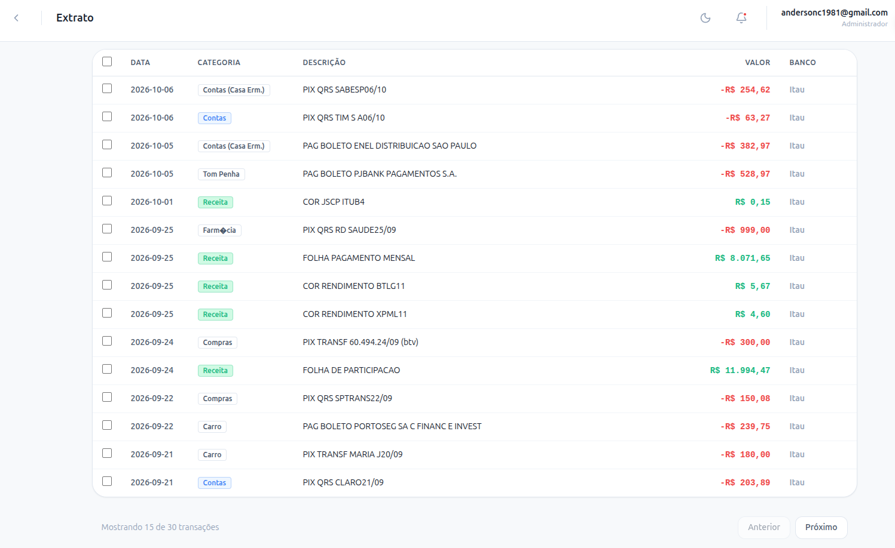
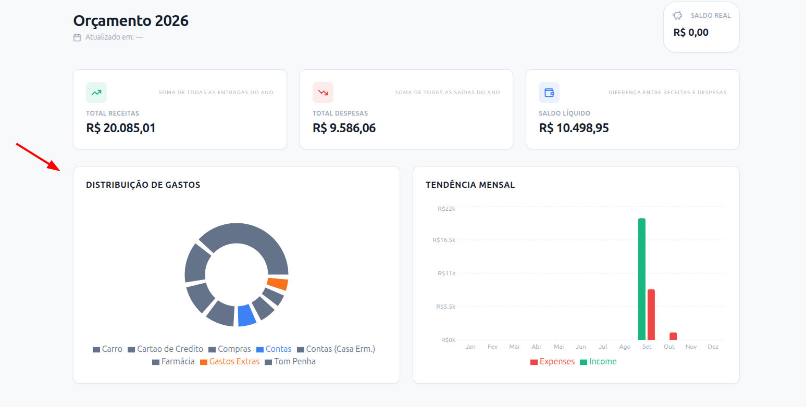

# Issues to Fix
## Fix accented character encoding when importing a .csv file (already fixed)

## Distribuição de Gastos Graph already fixed)
The colors of some categories is gone. When there are no data, the graph keep showing cached data stored somewhere.
